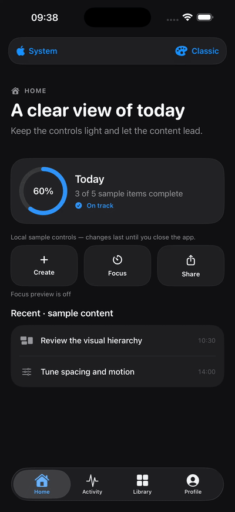
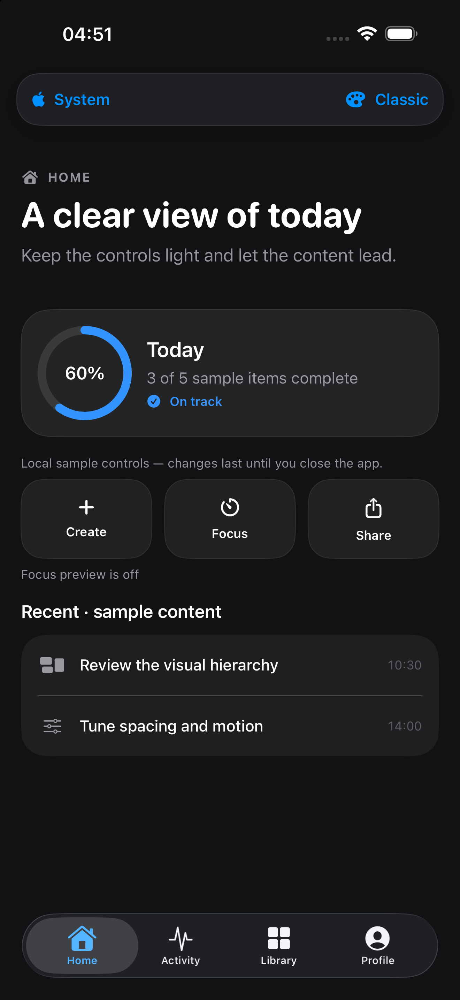
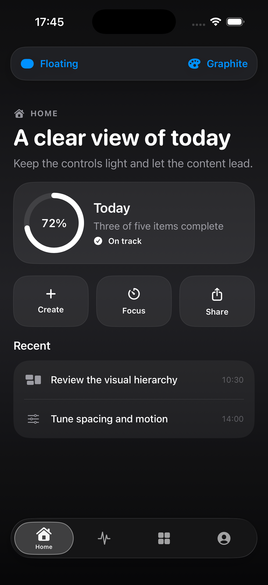
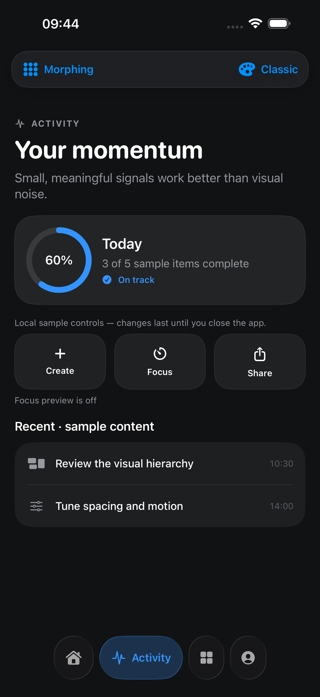

# Liquid Glass Tab Bars

Production-oriented SwiftUI tab bar patterns with native Liquid Glass, accessible fallbacks, and a reusable `LiquidUI` package.

[](https://www.swift.org)
[](https://developer.apple.com/ios/)
[](https://github.com/mikonyaa/LiquidGlassTabBars/actions/workflows/ci.yml)
[](LICENSE)

Part of the [Apple Design Templates](https://github.com/mikonyaa/Apple-Design-Templates) collection.

> This project is inspired by Apple's modern Liquid Glass design language. It is not affiliated with or endorsed by Apple.

## Preview



The demo includes three tab bar approaches:

1. **System** — a native `TabView`. On iOS 26, SwiftUI supplies the Liquid Glass appearance and interaction automatically.
2. **Floating** — one glass capsule with a moving active pill and optional selected label.
3. **Morphing** — separate interactive glass controls that expand the selected item.

| System / Classic | Floating / Graphite | Morphing / Classic |
| --- | --- | --- |
|  |  |  |

## Why this exists

Many Liquid Glass examples stop at a single button. This repository focuses on complete, understandable patterns that can be opened in Xcode, inspected, copied, and adapted without a backend or third-party dependency.

The first release starts with tab navigation because it demonstrates the most important rule: use system structure when it already provides the right behavior, and use custom glass only when the product needs a distinct interaction.

## Included

- `LiquidUI`, a zero-dependency Swift Package.
- A runnable iPhone and iPad demo project.
- Native iOS 26 Liquid Glass and iOS 17–25 material fallbacks.
- Four reusable component themes and two restrained demo backgrounds.
- Dynamic Type, Reduce Motion, and Reduce Transparency support.
- Deterministic previews and unit tests.
- English and Russian documentation.

## Requirements

- Xcode 26 or newer for native Liquid Glass APIs.
- iOS 26 or newer to see native Liquid Glass.
- iOS 17 or newer for the fallback implementation.
- Swift 6.

The package also compiles on macOS 14 or newer so its public API can be tested without an iOS runtime. The demo app targets iPhone and iPad.

## Quick start

Open the demo project:

```bash
open Examples/LiquidGlassDemo/LiquidGlassDemo.xcodeproj
```

Choose the `LiquidGlassDemo` scheme and an iOS Simulator, then run with `⌘R`. Use the two menus at the top of the demo to switch the tab bar style and background.

Optional: regenerate the Xcode project with XcodeGen if you prefer a generated project workflow:

```bash
cd Examples/LiquidGlassDemo
xcodegen generate
open LiquidGlassDemo.xcodeproj
```

XcodeGen is not required. The checked-in `.xcodeproj` remains the default path for beginners.

Run package tests:

```bash
swift test
```

Compile the demo app from Terminal:

```bash
xcodebuild \
  -project Examples/LiquidGlassDemo/LiquidGlassDemo.xcodeproj \
  -scheme LiquidGlassDemo \
  -destination 'generic/platform=iOS Simulator' \
  CODE_SIGNING_ALLOWED=NO \
  build
```

## Add LiquidUI to another project

Add `https://github.com/mikonyaa/LiquidGlassTabBars.git` in Xcode through **File → Add Package Dependencies**, then select the `LiquidUI` product.

For a local checkout, drag `Packages/LiquidUI` into Xcode or add that folder as a local package.

### Native system tab bar

Use the system approach when platform-native behavior and automatic adaptation are the priority:

```swift
enum AppTab: Hashable, Sendable {
    case home, activity, settings
}

@State private var selectedTab: AppTab = .home

SystemGlassTabView(selection: $selectedTab, tint: .purple) {
    HomeView()
        .tabItem { Label("Home", systemImage: "house.fill") }
        .tag(AppTab.home)

    ActivityView()
        .tabItem { Label("Activity", systemImage: "chart.bar.fill") }
        .tag(AppTab.activity)

    SettingsView()
        .tabItem { Label("Settings", systemImage: "gear") }
        .tag(AppTab.settings)
}
```

There is deliberately no custom blur in this component. On iOS 26, the system owns the tab bar's Liquid Glass rendering, contrast, and interaction.

### Custom floating tab bar

```swift
let items = [
    LiquidTabItem(id: AppTab.home, title: "Home", systemImage: "house.fill"),
    LiquidTabItem(id: AppTab.activity, title: "Activity", systemImage: "chart.bar.fill"),
    LiquidTabItem(id: AppTab.settings, title: "Settings", systemImage: "gear")
]

LiquidTabBar(
    selection: $selectedTab,
    items: items,
    variant: .floating,
    theme: .violet
)
```

Change `variant` to `.morphing` for the expanding control layout.

Place a custom bar in a bottom safe-area inset so scrolling content is never covered:

```swift
ContentView()
    .safeAreaInset(edge: .bottom, spacing: 0) {
        LiquidTabBar(
            selection: $selectedTab,
            items: items,
            variant: .floating,
            theme: .classic
        )
        .padding(.horizontal, 16)
        .padding(.vertical, 8)
    }
```

## Customization

Use a preset:

```swift
theme: .classic
theme: .violet
theme: .ocean
theme: .neutral
```

Or define a product-specific theme:

```swift
let brandTheme = LiquidTabBarTheme(
    tint: .mint,
    inactiveForeground: .secondary,
    fallbackFill: .black.opacity(0.90),
    fallbackBorder: .white.opacity(0.12),
    selectedFillOpacity: 0.16,
    selectedBorderOpacity: 0.42,
    shadowColor: .mint.opacity(0.12),
    shadowRadius: 16,
    itemSpacing: 10
)
```

See [Customization](Docs/Customization.md) for the reasoning behind each value.

## Project structure

```text
LiquidGlassTabBars/
├── Package.swift
├── Packages/LiquidUI/
│   ├── Package.swift
│   ├── Sources/LiquidUI/
│   └── Tests/LiquidUITests/
├── Examples/LiquidGlassDemo/
│   ├── LiquidGlassDemo.xcodeproj
│   └── LiquidGlassDemo/
├── Docs/
├── Assets/GIFs/
└── Assets/Screenshots/
```

## Design principles

- Prefer native `TabView` when it meets the product requirement.
- Keep glass on navigation and controls, not long-form content.
- Use one `GlassEffectContainer` for neighboring custom glass elements.
- Apply `glassEffect` after layout and appearance modifiers.
- Tint for meaning and selection, not decoration.
- Keep a readable fallback for Reduce Transparency and pre-iOS 26 systems.
- Preserve a 44-point minimum interaction target.

Read the full [Design Principles](Docs/DesignPrinciples.md).

## Learn how it works

- [Architecture](Docs/Architecture.md)
- [Getting Started](Docs/GettingStarted.md)
- [Customization](Docs/Customization.md)
- [Template Quality Checklist](Docs/TemplateQuality.md)
- [GitHub Launch Checklist](Docs/GitHubLaunchChecklist.md)

## Roadmap

See [ROADMAP.md](ROADMAP.md). Planned additions include more navigation patterns, settings, onboarding, paywalls, macOS menu bar templates, and adaptive iPad layouts.

## Contributing

Bug reports, accessibility improvements, documentation corrections, and focused component proposals are welcome. Read [CONTRIBUTING.md](CONTRIBUTING.md) before opening a pull request.

## License

Liquid Glass Tab Bars is available under the [MIT License](LICENSE).

Apple, Swift, SwiftUI, iPhone, iPad, and macOS are trademarks of Apple Inc.
